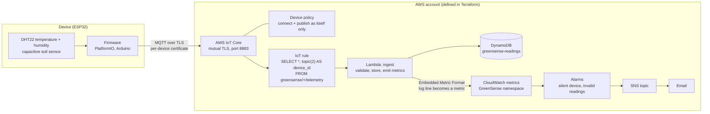
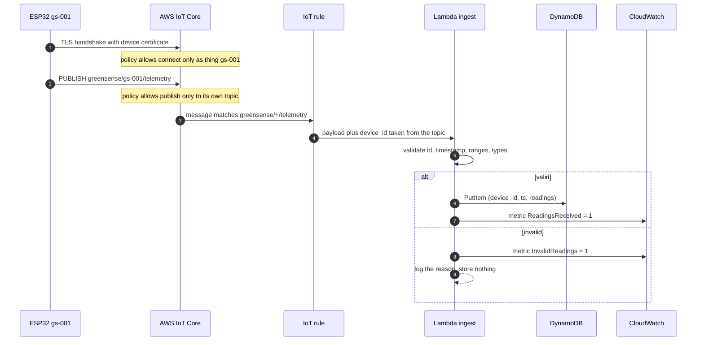
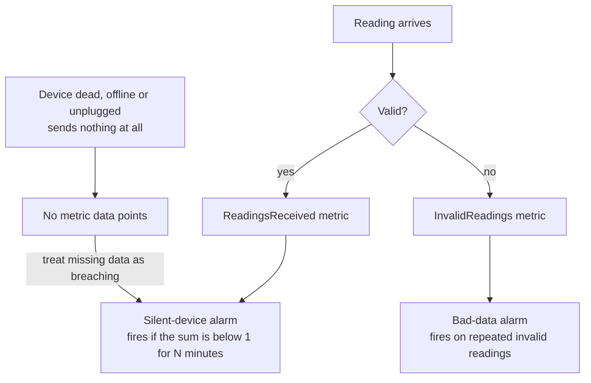
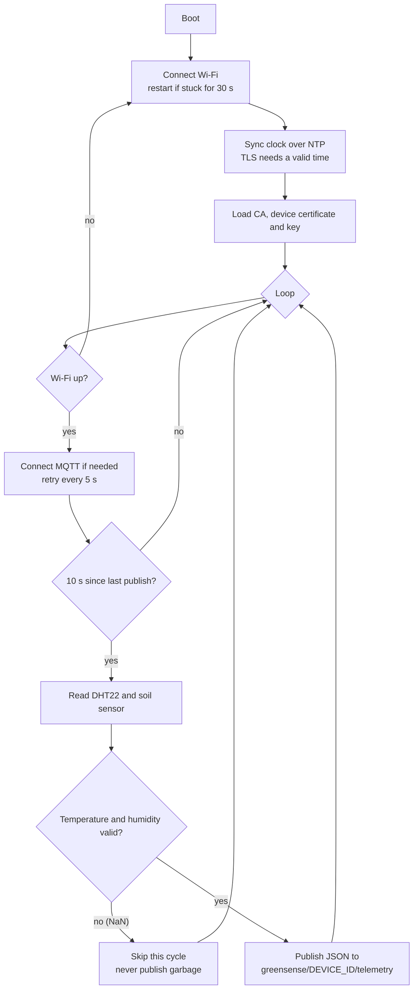

# GreenSense

[](https://github.com/sunusr143/greensense/actions/workflows/ci.yml)

An environmental monitoring pipeline from a **sensor board to a monitored cloud backend**. ESP32 boards read temperature, humidity and soil moisture and publish them to **AWS IoT Core** over MQTT with **mutual TLS**. An IoT rule routes each message to a **Lambda** that validates and stores it in **DynamoDB**, and **CloudWatch alarms** notify you by email when a device goes silent or starts sending bad data. Everything in AWS is defined in **Terraform**, and CI tests the cloud code, validates the Terraform and builds the firmware on every push.

The point of the project is the part beyond "blink an LED and print a number": per-device identity, least-privilege access, a backend that distrusts what it receives, and monitoring that notices when a device **stops** talking, not just when it says something wrong.

- [Status: what is verified and what is not](#status-what-is-verified-and-what-is-not)
- [Architecture](#architecture)
- [Quick start (no AWS, no hardware)](#quick-start-no-aws-no-hardware)
- [Device firmware](#device-firmware)
- [Message contract](#message-contract)
- [Identity and access](#identity-and-access)
- [Ingest and validation](#ingest-and-validation)
- [Data model](#data-model)
- [Monitoring and alarms](#monitoring-and-alarms)
- [Infrastructure (Terraform)](#infrastructure-terraform)
- [Deploying](#deploying)
- [CI](#ci)
- [Security](#security)
- [Failure modes](#failure-modes)
- [Testing](#testing)
- [Design decisions and trade-offs](#design-decisions-and-trade-offs)
- [Limitations and roadmap](#limitations-and-roadmap)
- [Repository layout](#repository-layout)

---

## Status: what is verified and what is not

This is a personal reference implementation. It has **not** been deployed to AWS and has **not** been flashed to a board.

| Part | Status |
|---|---|
| Lambda validation and handler | **6 unit tests pass** (`python3 -m unittest discover -s lambda`) |
| Ingest path end to end | **Runs locally**: `python3 simulator/simulate.py` pushes realistic readings, with injected faults, through the real handler into an in-memory table. No AWS needed |
| Terraform | `terraform fmt -check` and `terraform validate` run in CI. Validation is not a deployment: nothing here has been applied to a real account |
| Firmware | Built with PlatformIO in CI (`pio run`, with placeholder secrets). Not flashed or run on hardware, so sensor calibration, Wi-Fi behaviour and TLS against the real endpoint are untested |
| Deployed to AWS, real device connected | **Not done.** It needs an AWS account and a board |
| Alarms firing in practice | **Not observed.** They are defined and validated, not exercised |

Check the CI badge or the Actions tab for the current build and validation status. No field results are claimed.

---

## Architecture

### End to end



### What happens to one reading



### Monitoring: the case that matters



A dead sensor does not send bad values; it sends **nothing**. An alarm that only looks at data cannot see that. The silent-device alarm treats missing data as a failure, which is what makes it work.

---

## Quick start (no AWS, no hardware)

Python 3.9+ is enough. The Lambda and its tests use only the standard library; `boto3` is imported lazily and only inside AWS.

```bash
git clone https://github.com/sunusr143/greensense.git
cd greensense

python3 -m unittest discover -s lambda -v      # 6 tests
python3 simulator/simulate.py 60               # 60 steps, two devices, injected faults
```

### What the simulation does

`simulator/simulate.py` generates a daily temperature and humidity curve and a slowly drying soil reading for two devices, then deliberately injects faults: a stuck sensor reporting 999 °C on `gs-002`, and a missing humidity field on `gs-001`. Every reading goes through the **real** `handler` into an in-memory table.

```text
rejected gs-002 step 5: temp_c out of range (999)
rejected gs-001 step 11: humidity missing or not a number
rejected gs-002 step 22: temp_c out of range (999)
rejected gs-001 step 34: humidity missing or not a number
rejected gs-002 step 39: temp_c out of range (999)
rejected gs-002 step 56: temp_c out of range (999)
rejected gs-001 step 57: humidity missing or not a number

stored 113, rejected 7, rows in table 113
```

Of 120 readings, 113 are stored and the 7 faulty ones are rejected with a specific reason and **never reach the table**. The random generator is seeded, so the run is repeatable.

---

## Device firmware

`firmware/src/main.cpp`, built with PlatformIO using the Arduino framework for the `esp32dev` board.

### Hardware

| Part | Connection |
|---|---|
| ESP32 dev board | USB power and flashing |
| DHT22 (temperature, humidity) | Data to **GPIO 4**, power from 3V3 |
| Capacitive soil moisture sensor | Analog out to **GPIO 34** (an ADC1 pin, which keeps working while Wi-Fi is active), power from 3V3 |

Calibrate the soil sensor by reading the raw ADC value in dry air and in water, then set `SOIL_DRY` (default 3200) and `SOIL_WET` (default 1300) in `main.cpp`. The firmware maps the raw value linearly to 0 to 100 % and clamps it.

### Behaviour



Notable choices, each deliberate:

- **Skip, don't guess.** If the DHT22 read fails (`NaN`), the cycle is skipped. The cloud notices the silence; it never has to filter fabricated values.
- **Sync the clock before TLS.** Certificate validation needs a plausible time, and the payload carries a timestamp. The firmware waits for NTP (up to about 20 seconds) before connecting.
- **Reboot when stuck.** If Wi-Fi has not connected after 30 seconds the board restarts rather than hanging.
- **Client id equals the device id.** The IoT policy only lets a device connect as its own thing name, so `DEVICE_ID` in firmware must match the Thing name exactly.

### Libraries (pinned in `platformio.ini`)

`PubSubClient 2.8`, `DHT sensor library 1.4.6`, `Adafruit Unified Sensor 1.1.14`, `ArduinoJson 7.2.0`, on `espressif32 6.9.0`, with `MQTT_MAX_PACKET_SIZE=512`.

### Secrets

`firmware/include/secrets.h` holds the Wi-Fi credentials, the IoT endpoint, the device id and the three PEM blocks (Amazon Root CA 1, the device certificate, the device private key). It is **git-ignored**; copy `secrets.h.example` and fill it in. CI builds with the example file so the pipeline never needs real secrets.

---

## Message contract

**Topic:** `greensense/<device_id>/telemetry`

**Payload** (about 100 bytes, published every 10 seconds):

```json
{
  "device_id": "gs-001",
  "ts": 1760875200,
  "temp_c": 23.4,
  "humidity": 61.2,
  "soil_pct": 42.7
}
```

| Field | Type | Meaning |
|---|---|---|
| `device_id` | string | Sent by the device but **overridden by the topic** in the IoT rule (see below) |
| `ts` | integer | Unix seconds from the device clock |
| `temp_c` | number | Degrees Celsius |
| `humidity` | number | Relative humidity, percent |
| `soil_pct` | number | Soil moisture, percent, after calibration |

---

## Identity and access

Every board is its own AWS IoT **Thing** with its own **certificate**, generated by Terraform. All boards share one **policy**, written with a policy variable so it grants each device access only to itself:

```text
iot:Connect   on  client/${iot:Connection.Thing.ThingName}
iot:Publish   on  topic/greensense/${iot:Connection.Thing.ThingName}/telemetry
```

What that buys:

- **A device can connect only under its own name** (the MQTT client id must equal its Thing name) and **publish only to its own topic**. It cannot subscribe to anything, cannot publish to another device's topic, and cannot publish anywhere else.
- **One stolen board is one revoked certificate.** Deactivate that certificate in IoT Core and the rest of the fleet is unaffected.
- **No device can impersonate another.** The IoT rule selects `topic(2) AS device_id`, so the identity the backend uses is the topic segment (which the policy has already tied to the certificate), **not** the `device_id` field in the payload. A compromised device that lies in its payload changes nothing.

---

## Ingest and validation

`lambda/handler.py` is the only application code in the cloud. It treats every message as untrusted.

| Check | Rule |
|---|---|
| Device id | Must be a string of 1 to 64 characters |
| Timestamp | Must be a number within **24 hours** of server time (rejects stale and far-future data) |
| `temp_c` | Number from **-40 to 80** |
| `humidity` | Number from **0 to 100** |
| `soil_pct` | Number from **0 to 100** |
| Types | Booleans are rejected explicitly (in Python `True` is a number, which would otherwise pass) |

A valid reading is rounded to 2 decimals, converted for DynamoDB (which rejects floats, so values go through `Decimal(str(value))` to avoid binary rounding noise), stored, and counted. An invalid reading is **not stored**; it increments the `InvalidReadings` metric and logs the exact reason as a structured line.

### Metrics without a metrics API

The Lambda emits metrics by printing one JSON line in **CloudWatch Embedded Metric Format**. CloudWatch Logs turns that line into a metric in the `GreenSense` namespace with a `DeviceId` dimension, with no `cloudwatch:PutMetricData` permission and no API call in the hot path (the function only needs permission to write its own logs).

```json
{
  "_aws": {
    "Timestamp": 1760875200000,
    "CloudWatchMetrics": [{
      "Namespace": "GreenSense",
      "Dimensions": [["DeviceId"]],
      "Metrics": [{"Name": "ReadingsReceived", "Unit": "Count"}]
    }]
  },
  "DeviceId": "gs-001",
  "ReadingsReceived": 1
}
```

---

## Data model

DynamoDB table `greensense-readings`, on-demand billing, point-in-time recovery enabled.

| Key | Attribute | Type |
|---|---|---|
| Partition key | `device_id` | string |
| Sort key | `ts` | number (Unix seconds) |

A stored item:

```json
{ "device_id": "gs-001", "ts": 1760875200, "temp_c": 23.4, "humidity": 61.2, "soil_pct": 42.7 }
```

This layout makes the common query cheap: "readings for one device in a time range" is a single partition with a range condition on `ts`. A TTL attribute (`expires_at`) is declared but **disabled**; enabling it and having the Lambda write `expires_at` would cap retention.

---

## Monitoring and alarms

Two CloudWatch alarms are created **per device**, both notifying an SNS topic with an email subscription.

| Alarm | Metric | Condition | Missing data |
|---|---|---|---|
| `greensense-<id>-silent` | `ReadingsReceived` (Sum, 5 minute periods) | Below 1 for `ceil(silence_minutes / 5)` consecutive periods (default 15 minutes, so 3 periods) | **Breaching**: no data means silent |
| `greensense-<id>-invalid-readings` | `InvalidReadings` (Sum, 5 minute periods) | At least 3 in each of 2 consecutive periods | Not breaching |

Two things to expect:

- A new device **starts in `ALARM`** until its first reading arrives, because missing data counts as breaching. That is the correct behaviour for "is this device alive?" and worth knowing before you wonder why a fresh deployment is alarming.
- The notification email address must **confirm the SNS subscription** (AWS sends a confirmation email) before alerts are delivered.

---

## Infrastructure (Terraform)

Everything in AWS is in `terraform/` (Terraform 1.6 or newer; `aws ~> 5.60`, `archive ~> 2.4`).

| Resource | Purpose |
|---|---|
| `aws_iot_thing`, `aws_iot_certificate`, `aws_iot_thing_principal_attachment` | One identity per device, created with `for_each` over `device_ids` |
| `aws_iot_policy`, `aws_iot_policy_attachment` | The shared least-privilege device policy, attached to each certificate |
| `aws_iot_topic_rule` and `aws_lambda_permission` | Route `greensense/+/telemetry` to the Lambda and allow IoT to invoke it |
| `aws_lambda_function` and its IAM role | Python 3.12 ingest function, 10 second timeout. The role can only `dynamodb:PutItem` on the table and write to its own log group |
| `aws_cloudwatch_log_group` | Lambda logs, 30 day retention |
| `aws_dynamodb_table` | Readings, on-demand, point-in-time recovery |
| `aws_sns_topic`, `aws_sns_topic_subscription` | Alert delivery by email |
| `aws_cloudwatch_metric_alarm` (two per device) | Silent-device and invalid-readings alarms |

Variables:

| Variable | Default | Meaning |
|---|---|---|
| `region` | `eu-west-1` | AWS region |
| `device_ids` | `["gs-001"]` | One IoT Thing per entry, one board each. Add ids to add devices |
| `alert_email` | *(required)* | Where alarm emails go |
| `silence_minutes` | `15` | How long without data before the silent alarm fires |

**Adding a device** is a one-line change: add its id to `device_ids` and apply. Terraform creates the Thing, certificate, policy attachment and both alarms.

---

## Deploying

> This has not been run against a real AWS account. Treat the steps as a checklist to verify, not a guarantee.

```bash
cd terraform
terraform init
terraform apply -var alert_email=you@example.com        # confirm the SNS email afterwards
```

1. **Get the device credentials** (sensitive outputs):
   ```bash
   terraform output -json certificate_pem   # certificate for each device id
   terraform output -json private_keys      # private key for each device id
   ```
2. **Get the IoT endpoint:** `aws iot describe-endpoint --endpoint-type iot:Data-ATS`
3. **Download Amazon Root CA 1** from the Amazon Trust Services repository.
4. **Fill in `firmware/include/secrets.h`** from `secrets.h.example`: Wi-Fi, endpoint, `DEVICE_ID` (must equal the Thing name), the CA, the device certificate and the private key.
5. **Flash and watch:** `cd firmware && pio run -t upload && pio device monitor` (115200 baud).
6. **Verify the backend:** in the IoT Core test client subscribe to `greensense/+/telemetry`, then check the DynamoDB table and the `GreenSense` metrics namespace.

To verify the alarm path, unplug the board and wait for the silent alarm email.

---

## CI

`.github/workflows/ci.yml` runs on every push and pull request, in two jobs:

| Job | Steps |
|---|---|
| `cloud` | Lambda unit tests, the 60-step local simulation, then `terraform fmt -check`, `terraform init -backend=false` and `terraform validate` |
| `firmware` | Install PlatformIO, copy `secrets.h.example` to `secrets.h`, `pio run`, and upload `firmware.bin` as a build artifact |

Firmware is treated as a build artifact like any other: reproducible, versioned by the commit, and downloadable from the run. That is also the foundation for OTA updates (see the roadmap).

---

## Security

| Concern | Approach | Remaining work |
|---|---|---|
| Device identity | Per-device X.509 certificate, mutual TLS | Certificate rotation is not automated |
| Authorisation | Policy variables restrict each device to its own client id and topic | Review before adding subscribe or other actions |
| Spoofing | Backend identity comes from the topic, not the payload | None known |
| Untrusted input | Strict validation; invalid data is rejected and counted, never stored | Limits are fixed constants in code |
| Cloud least privilege | Lambda role: `PutItem` on one table and its own logs only | None known |
| **Private keys in Terraform state** | Certificates are generated by Terraform, so private keys end up in the state file | Use an encrypted remote backend with restricted access, or generate keys on the device or with the IoT fleet provisioning flow so keys never leave the board |
| Secrets in the repo | `secrets.h`, `*.pem`, `*.key`, state files and `*.tfvars` are git-ignored; CI uses placeholders | Confirm nothing sensitive was ever committed before making a fork public |
| **Secrets on the device** | Wi-Fi password and the private key live in flash | Enable ESP32 flash encryption and Secure Boot for devices that can be physically accessed |
| Data at rest | DynamoDB default encryption with an AWS-owned key | Use a customer-managed KMS key if policy requires it |
| Supply chain | Library and platform versions are pinned | Dependency scanning is not configured |

---

## Failure modes

| What goes wrong | What happens | How you find out |
|---|---|---|
| Sensor read fails | Firmware skips the cycle; nothing is published | Silent-device alarm if it persists |
| Board loses Wi-Fi | Reconnect loop; reboot if stuck for 30 s | Silent-device alarm if it persists |
| Device sends an out-of-range or malformed reading | Lambda rejects it, stores nothing, counts it | Invalid-readings alarm on repeats |
| Device clock is wrong (stale or far-future `ts`) | Rejected for a bad timestamp | Invalid-readings alarm |
| Device tries to publish to another topic or connect under another name | IoT Core refuses it (policy) | Connection or publish failure on the device |
| A device is compromised | Deactivate its certificate; others are unaffected | You decide to |
| DynamoDB write fails | The Lambda raises, and the invocation fails visibly in Lambda metrics and logs | Lambda error metrics; the reading is not stored |
| Device never sent anything yet | New alarm starts in `ALARM` | Expected until the first reading |

---

## Testing

| Layer | Tests |
|---|---|
| `lambda/test_handler.py` (6 tests) | A good reading is accepted; out-of-range values are rejected; missing fields and wrong types (including booleans) are rejected; stale and future timestamps are rejected; a valid reading is stored and emits `ReadingsReceived`; an invalid reading is **not** stored but **is** counted in `InvalidReadings` |
| `simulator/simulate.py` | Whole ingest path with injected faults, no AWS needed |
| Terraform | `fmt -check` and `validate` in CI |
| Firmware | Compiles in CI; hardware behaviour is untested |

The handler takes the table as an argument, which is what lets tests and the simulator run it against an in-memory fake instead of AWS.

---

## Design decisions and trade-offs

**One certificate and one identity per device.** Fleet-wide shared credentials mean a single leak compromises everything and revoking means touching every board. Per-device identity costs a little provisioning work and buys revocation of exactly one device.

**Policy variables instead of one policy per device.** A single policy using `${iot:Connection.Thing.ThingName}` is simple to review and scales to many devices, while still confining each one to its own name and topic.

**Take identity from the topic, not the payload.** The payload is attacker-controlled data. The topic is constrained by the policy. Using the topic in the rule makes impersonation structurally impossible rather than something validation has to catch.

**Alarm on silence as well as on bad data.** The most common failure in the field is a device that simply stops. Treating missing data as breaching is the cheapest way to catch it.

**Skip the cycle on a failed sensor read.** Publishing a last-known or default value hides the fault and corrupts the data. Staying silent makes the fault visible through the silence alarm.

**Validate on ingest and reject, don't repair.** Guessing what a malformed reading "should" have been invents data. Rejecting and counting it keeps stored data trustworthy and makes the failure measurable.

**Embedded Metric Format for metrics.** It turns a log line into a metric with no metrics API call, no `PutMetricData` permission and no added latency.

**DynamoDB keyed by device and time.** It matches the one access pattern that matters (a device over a time range), needs no capacity planning on-demand, and has point-in-time recovery for free.

**Firmware built in CI.** A firmware binary that only exists on one laptop cannot be reproduced, audited or rolled out safely. Building it in the pipeline fixes that and prepares for OTA.

---

## Limitations and roadmap

Known limitations:

- Never deployed and never run on hardware; calibration, radio and real TLS behaviour are unverified.
- Private keys pass through Terraform state (see [Security](#security)).
- Validation limits (`-40` to `80`, `0` to `100`) are constants in code, not per-sensor configuration.
- No retention policy is active (TTL is declared but disabled), so data accumulates.
- No dashboard; data is only queryable in DynamoDB and the metrics are only visible in CloudWatch.
- No over-the-air updates; changing firmware means reflashing over USB.
- One region and one account; no multi-environment setup.
- Two alarms per device scale linearly with fleet size and cost.

Roadmap, roughly in order of value:

1. Deploy to a real account and flash a real board; record what breaks.
2. Move key generation off Terraform state (device-generated keys with IoT fleet provisioning).
3. Enable DynamoDB TTL with an `expires_at` written by the Lambda.
4. OTA updates with signed images and staged rollout (see the companion [esp32-ota-rollout](https://github.com/sunusr143/esp32-ota-rollout) project for the rollout logic).
5. A dashboard (Grafana or CloudWatch dashboard) over the stored data.
6. A Raspberry Pi gateway variant for non-Wi-Fi sensors (see [rpi-edge-gateway](https://github.com/sunusr143/rpi-edge-gateway)).

---

## Repository layout

```text
greensense/
├── firmware/
│   ├── platformio.ini            board, framework and pinned libraries
│   ├── src/main.cpp              sensor reads, TLS, MQTT publish loop
│   └── include/secrets.h.example template for credentials and certificates (copy to secrets.h)
├── lambda/
│   ├── handler.py                validate, store, emit metrics
│   └── test_handler.py           6 unit tests
├── simulator/simulate.py         local end-to-end run with injected faults
├── terraform/
│   ├── main.tf                   IoT, Lambda, DynamoDB, SNS, alarms
│   ├── variables.tf
│   ├── outputs.tf                certificates and keys (sensitive)
│   └── .terraform.lock.hcl       provider versions
└── .github/workflows/ci.yml      tests, Terraform validate, firmware build
```
